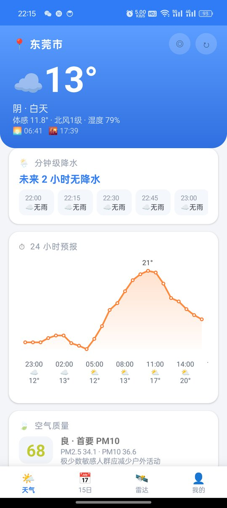

# 微天气 (wxapp)

无广告 · 无会员 · 数据开放的天气 App。

- 🌐 官网：https://weather.modelx.top
- 📲 [下载 APK (v1.2)](https://weather.modelx.top/download/wxapp-v1.2.apk)
- 开源协议：MIT · 作者 zhenhua



## 特性

- 实时天气 / 24 小时曲线 / 15 日预报 / 空气质量 / 分钟级降水 / 气象预警 / 降水雷达 / 生活指数
- 安装包 < 1 MB，纯 Android 原生控件，**零三方依赖**
- 无广告、无会员、无付费墙
- 客户端 + 后端全部开源，可自建服务器，App 内一键切换服务器地址

## 目录结构

```
weather-android/   Android 客户端（Kotlin，包名 top.modelx.weather，minSdk 24，仅系统框架）
weather-server/    后端（Python FastAPI + MySQL）
site/              官网静态页面
```

## 快速开始

### Android

```bash
cd weather-android
gradle assembleDebug        # 或放入 Android Studio
# 产物 app/build/outputs/apk/debug/app-debug.apk
```

默认服务器地址 `https://weather.modelx.top`，可在「我的 → 服务器地址」修改。

### 后端

见 [weather-server/DEPLOY.md](weather-server/DEPLOY.md)。

## 数据来源

| 数据 | 来源 |
|---|---|
| 预报 / 空气质量 | [Open-Meteo](https://open-meteo.com)（免 key 开放 API） |
| 气象预警 | 中央气象台 NMC |
| 雷达 | [RainViewer](https://www.rainviewer.com) |
| 全国行政区划 | [DataV.GeoAtlas](https://datav.aliyun.com/portal/school/atlas/area_selector) |

## License

MIT
